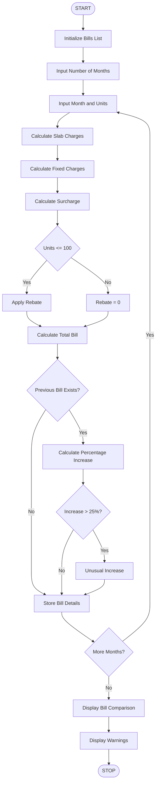

# Progressive Electricity Billing System – Python Project

## 1. Problem Statement

Develop a Python program to calculate household electricity bills using a progressive slab-based billing system.

The program should:

- Accept monthly electricity consumption in units.
- Calculate energy charges using multiple consumption slabs.
- Add fixed charges and surcharges.
- Apply rebates based on consumption.
- Calculate the final electricity bill.
- Compare electricity bills across multiple months.
- Identify unusual increases in monthly bills.

Objective: To help households calculate electricity expenses accurately and monitor monthly consumption patterns.

## 2. Algorithm

1. Start the program.
2. Initialize an empty list to store monthly bill details.
3. Get the number of months.
4. For each month:
   - Read the month name and electricity units.
   - Calculate charges using progressive consumption slabs.
   - Add fixed charges.
   - Calculate the surcharge.
   - Apply the eligible rebate.
   - Calculate the total bill.
5. Compare the current bill with the previous month's bill.
6. If the bill increases by more than 25%, identify it as an unusual increase.
7. Display the monthly bill details.
8. Display the comparison of all monthly bills.
9. Stop the program.

## 3. Flowchart


## 4. Python Source Code

```
# Progressive Electricity Billing Systembills = []# Electricity slab ratesslabs = [    (50, 1.45),    (100, 2.80),    (100, 3.70),    (100, 4.80),    (float('inf'), 6.60)]# Function to calculate electricity chargesdef calculate_energy_charge(units):    energy_charge = 0    remaining = units    for limit, rate in slabs:        consumed = min(remaining, limit)        energy_charge += consumed * rate        remaining -= consumed        if remaining <= 0:            break    return energy_charge# Get number of monthsn = int(input("Enter number of months: "))for i in range(n):    print("\nMonth", i + 1)    month = input("Enter month name: ")    units = float(input("Enter electricity units: "))    if units < 0:        print("Invalid units! Enter positive units.")        continue    # Calculate bill components    energy = calculate_energy_charge(units)    fixed_charge = 50    surcharge = energy * 0.05    if units <= 100:        rebate = 20    else:
```

## 5. Sample Input

```
Enter number of months: 3

Month 1
Enter month name: January
Enter electricity units: 80

Month 2
Enter month name: February
Enter electricity units: 120

Month 3
Enter month name: March
Enter electricity units: 200
```

## 6. Sample Output

```
----- ELECTRICITY BILL -----
Month: January
Units Consumed: 80
Energy Charges: Rs. 156.5
Fixed Charges: Rs. 50
Surcharge: Rs. 7.83
Rebate: Rs. 20
Total Bill: Rs. 194.33
Status: Normal

----- ELECTRICITY BILL -----
Month: February
Units Consumed: 120
Energy Charges: Rs. 268.0
Fixed Charges: Rs. 50
Surcharge: Rs. 13.4
Rebate: Rs. 0
Total Bill: Rs. 331.4
Status: Unusual Increase

----- ELECTRICITY BILL -----
Month: March
Units Consumed: 200
Energy Charges: Rs. 537.5
Fixed Charges: Rs. 50
Surcharge: Rs. 26.88
Rebate: Rs. 0
Total Bill: Rs. 614.38
Status: Unusual Increase

========== MONTHLY BILL COMPARISON ==========

Month        Units        Bill (Rs.)      Status
January      80           194.33          Normal
February     120          331.40          Unusual Increase
March        200          614.38          Unusual Increase

========== ANALYSIS ==========

Warning: February has an unusual increase of 70.54 %
Warning: March has an unusual increase of 85.30 %

Billing calculation completed!
```

## 7. Mermaid Flowchart Code


## 8. Formula Used

1\. Energy Charges

\\[ EC=\sum(\text{Units in slab}\times\text{Rate}) \\]

2\. Surcharge

\\[ SC=EC\times 5/100 \\]

3\. Total Electricity Bill

\\[ Total=EC+FC+SC-Rebate \\]

4\. Percentage Increase

\\[ Increase=\frac{Current-Previous}{Previous}\times100 \\]

If the increase is greater than 25%, the program identifies it as an unusual increase.

## 9. Conclusion

The Progressive Electricity Billing System calculates household electricity bills using multiple consumption slabs, fixed charges, surcharges, and rebates. It compares monthly electricity bills and identifies unusual increases. This program helps users monitor electricity consumption and manage household expenses efficiently.

Note: The slab rates and charges are assumed values for an academic Python project, not official electricity tariff rates.
