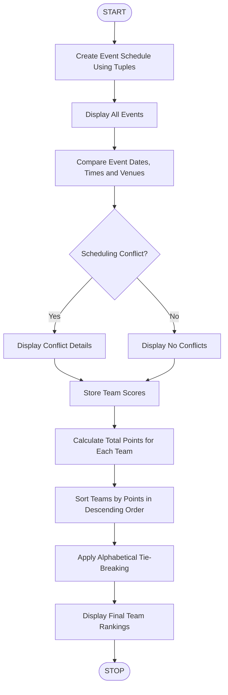

# Multi-Event Sports Scheduling and Scoring

## 1. Problem Statement

Develop a Python program to manage a multi-event sports competition using lists and tuples. The program should:

1. Store multiple sports events with event names, dates, times, and venues.
2. Identify scheduling conflicts when two events are scheduled at the same date, time, and venue.
3. Store team scores for different events.
4. Calculate the total points earned by each team.
5. Generate final team rankings based on total points.
6. Apply alphabetical order to break ties between teams with equal points.

## 2. Algorithm

1. Start the program.
2. Create a list of sports events using tuples.
3. Display all scheduled events.
4. Compare each event with other events to identify scheduling conflicts.
5. Create a list containing team scores.
6. Calculate the total points for each team.
7. Store team names and total points in a dictionary.
8. Sort teams based on total points in descending order.
9. If points are equal, sort teams alphabetically.
10. Display total points and final rankings.
11. Stop the program.

## 3. Flowchart



## 4. Python Source Code

```
# Multi-Event Sports Scheduling and Scoring# Event schedule using tuplesevents = [    ("Cricket", "2026-11-01", "09:00", "Ground A"),    ("Football", "2026-11-01", "10:00", "Ground B"),    ("Basketball", "2026-11-01", "09:00", "Ground A"),    ("Volleyball", "2026-11-02", "11:00", "Ground C")]print("===== SPORTS EVENT SCHEDULE =====")for event in events:    print(event)# Check scheduling conflictsprint("\n===== SCHEDULING CONFLICTS =====")conflict_found = Falsefor i in range(len(events)):    for j in range(i + 1, len(events)):        if (events[i][1] == events[j][1] and            events[i][2] == events[j][2] and            events[i][3] == events[j][3]):            print(events[i][0], "and", events[j][0],                  "have a scheduling conflict.")            conflict_found = Trueif not conflict_found:    print("No scheduling conflicts found.")# Team scores using tuplesscores = [
```

## 5. Sample Input

The following data is used in the program:

Event Schedule

| Event      | Date       | Time  | Venue    |
| ---------- | ---------- | ----- | -------- |
| Cricket    | 2026-11-01 | 09:00 | Ground A |
| Football   | 2026-11-01 | 10:00 | Ground B |
| Basketball | 2026-11-01 | 09:00 | Ground A |
| Volleyball | 2026-11-02 | 11:00 | Ground C |

Team Scores

| Team   | Event      | Points |
| ------ | ---------- | ------ |
| Team A | Cricket    | 30     |
| Team B | Cricket    | 20     |
| Team C | Cricket    | 25     |
| Team A | Football   | 20     |
| Team B | Football   | 30     |
| Team C | Football   | 15     |
| Team A | Basketball | 25     |
| Team B | Basketball | 15     |
| Team C | Basketball | 25     |
| Team A | Volleyball | 10     |
| Team B | Volleyball | 20     |
| Team C | Volleyball | 15     |

## 6. Sample Output

```
===== SPORTS EVENT SCHEDULE =====
('Cricket', '2026-11-01', '09:00', 'Ground A')
('Football', '2026-11-01', '10:00', 'Ground B')
('Basketball', '2026-11-01', '09:00', 'Ground A')
('Volleyball', '2026-11-02', '11:00', 'Ground C')

===== SCHEDULING CONFLICTS =====
Cricket and Basketball have a scheduling conflict.

===== TEAM TOTAL POINTS =====
Team A : 85
Team B : 85
Team C : 80

===== FINAL RANKINGS =====
1 . Team A - 85 points
2 . Team B - 85 points
3 . Team C - 80 points

Program completed successfully.
```

## 7. Mermaid Flowchart Code


## 8. Concepts Used

| Concept                | Application                      |
| ---------------------- | -------------------------------- |
| Lists                  | Store multiple events and scores |
| Tuples                 | Store event and score details    |
| Nested loops           | Compare events for conflicts     |
| Dictionary             | Calculate team-wise total points |
| Conditional statements | Identify conflicts               |
| Sorting                | Generate final rankings          |
| Lambda function        | Apply tie-breaking rules         |
| enumerate()            | Display ranking numbers          |

Result: The program successfully identifies scheduling conflicts, calculates team-wise total scores, and generates final sports competition rankings using Python lists, tuples, dictionaries, and sorting.
