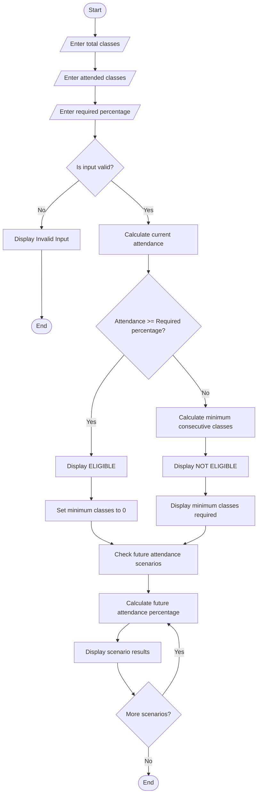

# Attendance Recovery Computation – Python Program

## 1. Problem Statement

Develop a Python program to calculate a student's current attendance percentage and determine the minimum number of consecutive classes the student must attend to reach the required eligibility threshold.

The program should:

- Accept total conducted classes and attended classes.
- Calculate the current attendance percentage.
- Accept the minimum required attendance percentage.
- Calculate the minimum consecutive classes required to reach eligibility.
- Analyze different future attendance scenarios.
- Display whether the student is eligible or not.

## 2. Algorithm

1. Start the program.
2. Read the total number of classes conducted.
3. Read the number of classes attended.
4. Read the required attendance percentage.
5. Calculate current attendance percentage:

\\[ Attendance = \frac{Attended}{Conducted}\times100 \\]

6. Check whether the current attendance meets the eligibility threshold.
7. If eligible, display the eligible status.
8. Otherwise, calculate the minimum consecutive classes required:

\\[ \frac{A+x}{T+x}\times100 \geq R \\]

Where:

- A = Classes attended
- T = Total classes conducted
- x = Additional consecutive classes
- R = Required attendance percentage

9. Calculate attendance under different future scenarios.
10. Display all results.
11. Stop.

## 3. Flowchart



## 4. Python Source Code

```
else:    # Calculate current attendance    current_percentage = (attended_classes / total_classes) * 100    print("\n----- CURRENT ATTENDANCE -----")    print("Total Classes:", total_classes)    print("Attended Classes:", attended_classes)    print("Current Attendance: {:.2f}%".format(current_percentage))    print("Required Attendance:", required_percentage, "%")    # Eligibility check    if current_percentage >= required_percentage:        print("\nStatus: ELIGIBLE")        print("You have already reached the required attendance.")        minimum_classes = 0    else:        # Calculate minimum consecutive classes        minimum_classes = math.ceil(            (required_percentage * total_classes / 100 - attended_classes)            / (1 - required_percentage / 100)        )        print("\nStatus: NOT ELIGIBLE")        print("Minimum consecutive classes required:",              minimum_classes)    # Future attendance scenarios    print("\n----- FUTURE ATTENDANCE SCENARIOS -----")    scenarios = [5, 10, 15, 20, 30]    for future_classes in scenarios:        future_attendance = (            (attended_classes + future_classes) /            (total_classes + future_classes)        ) * 100        print("\nIf you attend", future_classes, "more classes:")        print("Future Attendance: {:.2f}%".format(future_attendance))        if future_attendance >= required_percentage:            print("Status: ELIGIBLE")        else:            print("Status: NOT ELIGIBLE")    print("\n===== END OF PROGRAM =====")
```

## 5. Sample Input

```
Enter total conducted classes: 100
Enter attended classes: 65
Enter required attendance percentage: 75
```

## 6. Sample Output

```
===== ATTENDANCE RECOVERY COMPUTATION =====

----- CURRENT ATTENDANCE -----
Total Classes: 100
Attended Classes: 65
Current Attendance: 65.00%
Required Attendance: 75.0 %

Status: NOT ELIGIBLE
Minimum consecutive classes required: 40

----- FUTURE ATTENDANCE SCENARIOS -----

If you attend 5 more classes:
Future Attendance: 66.67%
Status: NOT ELIGIBLE

If you attend 10 more classes:
Future Attendance: 68.18%
Status: NOT ELIGIBLE

If you attend 15 more classes:
Future Attendance: 69.57%
Status: NOT ELIGIBLE

If you attend 20 more classes:
Future Attendance: 70.83%
Status: NOT ELIGIBLE

If you attend 30 more classes:
Future Attendance: 73.08%
Status: NOT ELIGIBLE

===== END OF PROGRAM =====
```

## 7. Mermaid Flowchart Code


The Attendance Recovery Computation program successfully calculates the current attendance percentage, checks eligibility, determines the minimum consecutive classes required to achieve the eligibility threshold, and evaluates different future attendance scenarios using Python.

Program Completed


