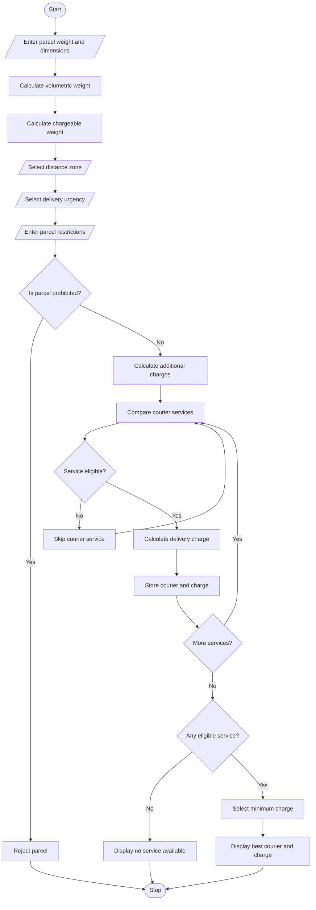

# Courier Charge Optimization – Python Program

## 1. Problem Statement

Develop a Python program to calculate courier delivery charges based on parcel weight, dimensions, distance zones, delivery urgency, and declared restrictions.

The program should:

- Accept parcel weight, length, width, and height.
- Calculate actual weight and volumetric weight.
- Determine delivery charges based on distance zones.
- Apply additional charges for urgent delivery.
- Check restrictions such as fragile, liquid, and prohibited items.
- Compare different courier service options.
- Select the most economical eligible courier service.
- Display the final delivery charge and selected service.

## 2. Algorithm

1. Start the program.
2. Enter parcel weight, length, width, and height.
3. Calculate volumetric weight using:

\\[ \text{Volumetric Weight} = \frac{L \times W \times H}{5000} \\]

4. Calculate chargeable weight by selecting the maximum of actual weight and volumetric weight.
5. Enter the distance zone (Local, Regional, National).
6. Enter delivery urgency (Normal or Express).
7. Enter parcel restrictions (Fragile, Liquid, Prohibited).
8. Check whether the parcel is eligible for delivery.
9. Calculate charges for different courier services.
10. Compare the eligible courier charges.
11. Select the courier with the lowest delivery charge.
12. Display all courier options and the best option.
13. Stop.

## 3. Flowchart


## 4. Python Source Code

```
# Courier Charge Optimizationprint("===================================")print("     COURIER CHARGE OPTIMIZATION")print("===================================")# Input parcel detailsweight = float(input("Enter parcel weight (kg): "))length = float(input("Enter length (cm): "))width = float(input("Enter width (cm): "))height = float(input("Enter height (cm): "))# Calculate volumetric weightvolumetric_weight = (length * width * height) / 5000# Calculate chargeable weightchargeable_weight = max(weight, volumetric_weight)print("\nActual Weight:", weight, "kg")print("Volumetric Weight:", round(volumetric_weight, 2), "kg")print("Chargeable Weight:", round(chargeable_weight, 2), "kg")# Distance zoneprint("\nDistance Zones:")print("1. Local")print("2. Regional")print("3. National")zone = int(input("Select distance zone (1-3): "))zone_rates = {    1: 40,    2: 70,    3: 100
```

## 5. Sample Input

```
Enter parcel weight (kg): 2

Enter length (cm): 30
Enter width (cm): 20
Enter height (cm): 15

Select distance zone (1-3): 2

Select urgency (1-2): 2

Select restriction (1-4): 2
```

## 6. Sample Output

```
===================================
     COURIER CHARGE OPTIMIZATION
===================================

Actual Weight: 2.0 kg
Volumetric Weight: 1.8 kg
Chargeable Weight: 2.0 kg

========== COURIER COMPARISON ==========

Fast Express - Rs. 250.0
Speed Courier - Rs. 230.0
Budget Delivery - Not eligible for fragile parcels

========== FINAL RESULT ==========

Selected Courier: Speed Courier
Minimum Delivery Charge: Rs. 230.0

Thank you for using our system!
```

## 7. Mermaid Flowchart Code


## 4. Python Source Code

```
# Courier Charge Optimizationprint("===================================")print("     COURIER CHARGE OPTIMIZATION")print("===================================")# Input parcel detailsweight = float(input("Enter parcel weight (kg): "))length = float(input("Enter length (cm): "))width = float(input("Enter width (cm): "))height = float(input("Enter height (cm): "))# Calculate volumetric weightvolumetric_weight = (length * width * height) / 5000# Calculate chargeable weightchargeable_weight = max(weight, volumetric_weight)print("\nActual Weight:", weight, "kg")print("Volumetric Weight:", round(volumetric_weight, 2), "kg")print("Chargeable Weight:", round(chargeable_weight, 2), "kg")# Distance zoneprint("\nDistance Zones:")print("1. Local")print("2. Regional")print("3. National")zone = int(input("Select distance zone (1-3): "))zone_rates = {    1: 40,    2: 70,    3: 100
```

## 5. Sample Input

```
Enter parcel weight (kg): 2

Enter length (cm): 30
Enter width (cm): 20
Enter height (cm): 15

Select distance zone (1-3): 2

Select urgency (1-2): 2

Select restriction (1-4): 2
```

## 6. Sample Output

```
===================================
     COURIER CHARGE OPTIMIZATION
===================================

Actual Weight: 2.0 kg
Volumetric Weight: 1.8 kg
Chargeable Weight: 2.0 kg

========== COURIER COMPARISON ==========

Fast Express - Rs. 250.0
Speed Courier - Rs. 230.0
Budget Delivery - Not eligible for fragile parcels

========== FINAL RESULT ==========

Selected Courier: Speed Courier
Minimum Delivery Charge: Rs. 230.0

Thank you for using our system!
```

## 7. Mermaid Flowchart Code

You can paste this code into [Mermaid Live Editor](https://mermaid.live/?utm_source=chatgpt.com) to generate your flowchart.

\#chatgpt-mermaid-\_r_u2\_{font-family:-apple-system-body,ui-sans-serif,-apple-system,system-ui,"Segoe UI",Helvetica,"Apple Color Emoji",Arial,sans-serif,"Segoe UI Emoji","Segoe UI Symbol";font-size:16px;fill:rgb(237, 237, 237);}@keyframes edge-animation-frame{from{stroke-dashoffset:0;}}@keyframes dash{to{stroke-dashoffset:0;}}#chatgpt-mermaid-\_r_u2\_ .edge-animation-slow{stroke-dasharray:9,5!important;stroke-dashoffset:900;animation:dash 50s linear infinite;stroke-linecap:round;}#chatgpt-mermaid-\_r_u2\_ .edge-animation-fast{stroke-dasharray:9,5!important;stroke-dashoffset:900;animation:dash 20s linear infinite;stroke-linecap:round;}#chatgpt-mermaid-\_r_u2\_ .error-icon{fill:rgb(48, 48, 48);}#chatgpt-mermaid-\_r_u2\_ .error-text{fill:rgb(237, 237, 237);stroke:rgb(237, 237, 237);}#chatgpt-mermaid-\_r_u2\_ .edge-thickness-normal{stroke-width:1px;}#chatgpt-mermaid-\_r_u2\_ .edge-thickness-thick{stroke-width:3.5px;}#chatgpt-mermaid-\_r_u2\_ .edge-pattern-solid{stroke-dasharray:0;}#chatgpt-mermaid-\_r_u2\_ .edge-thickness-invisible{stroke-width:0;fill:none;}#chatgpt-mermaid-\_r_u2\_ .edge-pattern-dashed{stroke-dasharray:3;}#chatgpt-mermaid-\_r_u2\_ .edge-pattern-dotted{stroke-dasharray:2;}#chatgpt-mermaid-\_r_u2\_ .marker{fill:rgb(175, 175, 175);stroke:rgb(175, 175, 175);}#chatgpt-mermaid-\_r_u2\_ .marker.cross{stroke:rgb(175, 175, 175);}#chatgpt-mermaid-\_r_u2\_ svg{font-family:-apple-system-body,ui-sans-serif,-apple-system,system-ui,"Segoe UI",Helvetica,"Apple Color Emoji",Arial,sans-serif,"Segoe UI Emoji","Segoe UI Symbol";font-size:16px;}#chatgpt-mermaid-\_r_u2\_ p{margin:0;}#chatgpt-mermaid-\_r_u2\_ .label{font-family:-apple-system-body,ui-sans-serif,-apple-system,system-ui,"Segoe UI",Helvetica,"Apple Color Emoji",Arial,sans-serif,"Segoe UI Emoji","Segoe UI Symbol";color:rgb(237, 237, 237);}#chatgpt-mermaid-\_r_u2\_ .cluster-label text{fill:rgb(237, 237, 237);}#chatgpt-mermaid-\_r_u2\_ .cluster-label span{color:rgb(237, 237, 237);}#chatgpt-mermaid-\_r_u2\_ .cluster-label span p{background-color:transparent;}#chatgpt-mermaid-\_r_u2\_ .label text,#chatgpt-mermaid-\_r_u2\_ span{fill:rgb(237, 237, 237);color:rgb(237, 237, 237);}#chatgpt-mermaid-\_r_u2\_ .node rect,#chatgpt-mermaid-\_r_u2\_ .node circle,#chatgpt-mermaid-\_r_u2\_ .node ellipse,#chatgpt-mermaid-\_r_u2\_ .node polygon,#chatgpt-mermaid-\_r_u2\_ .node path{fill:rgb(9, 23, 44);stroke:rgb(31, 78, 148);stroke-width:1px;}#chatgpt-mermaid-\_r_u2\_ .rough-node .label text,#chatgpt-mermaid-\_r_u2\_ .node .label text,#chatgpt-mermaid-\_r_u2\_ .image-shape .label,#chatgpt-mermaid-\_r_u2\_ .icon-shape .label{text-anchor:middle;}#chatgpt-mermaid-\_r_u2\_ .node .katex path{fill:#000;stroke:#000;stroke-width:1px;}#chatgpt-mermaid-\_r_u2\_ .rough-node .label,#chatgpt-mermaid-\_r_u2\_ .node .label,#chatgpt-mermaid-\_r_u2\_ .image-shape .label,#chatgpt-mermaid-\_r_u2\_ .icon-shape .label{text-align:center;}#chatgpt-mermaid-\_r_u2\_ .node.clickable{cursor:pointer;}#chatgpt-mermaid-\_r_u2\_ .root .anchor path{fill:rgb(175, 175, 175)!important;stroke-width:0;stroke:rgb(175, 175, 175);}#chatgpt-mermaid-\_r_u2\_ .arrowheadPath{fill:rgb(175, 175, 175);}#chatgpt-mermaid-\_r_u2\_ .edgePath .path{stroke:rgb(175, 175, 175);stroke-width:1px;}#chatgpt-mermaid-\_r_u2\_ .flowchart-link{stroke:rgb(175, 175, 175);fill:none;}#chatgpt-mermaid-\_r_u2\_ .edgeLabel{background-color:rgb(0, 0, 0);text-align:center;}#chatgpt-mermaid-\_r_u2\_ .edgeLabel p{background-color:rgb(0, 0, 0);}#chatgpt-mermaid-\_r_u2\_ .edgeLabel rect{opacity:0.5;background-color:rgb(0, 0, 0);fill:rgb(0, 0, 0);}#chatgpt-mermaid-\_r_u2\_ .labelBkg{background-color:rgba(0, 0, 0, 0.5);}#chatgpt-mermaid-\_r_u2\_ .cluster rect{fill:rgb(48, 48, 48);stroke:rgba(255, 255, 255, 0.15);stroke-width:1px;}#chatgpt-mermaid-\_r_u2\_ .cluster text{fill:rgb(237, 237, 237);}#chatgpt-mermaid-\_r_u2\_ .cluster span{color:rgb(237, 237, 237);}#chatgpt-mermaid-\_r_u2\_ div.mermaidTooltip{position:absolute;text-align:center;max-width:200px;padding:2px;font-family:-apple-system-body,ui-sans-serif,-apple-system,system-ui,"Segoe UI",Helvetica,"Apple Color Emoji",Arial,sans-serif,"Segoe UI Emoji","Segoe UI Symbol";font-size:12px;background:rgb(48, 48, 48);border:1px solid rgba(255, 255, 255, 0.15);border-radius:2px;pointer-events:none;z-index:100;}#chatgpt-mermaid-\_r_u2\_ .flowchartTitleText{text-anchor:middle;font-size:18px;fill:rgb(237, 237, 237);}#chatgpt-mermaid-\_r_u2\_ rect.text{fill:none;stroke-width:0;}#chatgpt-mermaid-\_r_u2\_ .icon-shape,#chatgpt-mermaid-\_r_u2\_ .image-shape{background-color:rgb(0, 0, 0);text-align:center;}#chatgpt-mermaid-\_r_u2\_ .icon-shape p,#chatgpt-mermaid-\_r_u2\_ .image-shape p{background-color:rgb(0, 0, 0);padding:2px;}#chatgpt-mermaid-\_r_u2\_ .icon-shape .label rect,#chatgpt-mermaid-\_r_u2\_ .image-shape .label rect{opacity:0.5;background-color:rgb(0, 0, 0);fill:rgb(0, 0, 0);}#chatgpt-mermaid-\_r_u2\_ .label-icon{display:inline-block;height:1em;overflow:visible;vertical-align:-0.125em;}#chatgpt-mermaid-\_r_u2\_ .node .label-icon path{fill:currentColor;stroke:revert;stroke-width:revert;}#chatgpt-mermaid-\_r_u2\_ .node .neo-node{stroke:rgb(31, 78, 148);}#chatgpt-mermaid-\_r_u2\_ [data-look="neo"].node rect,#chatgpt-mermaid-\_r_u2\_ [data-look="neo"].cluster rect,#chatgpt-mermaid-\_r_u2\_ [data-look="neo"].node polygon{stroke:url(#chatgpt-mermaid-\_r_u2\_-gradient);filter:drop-shadow( 1px 2px 2px rgba(185,185,185,1));}#chatgpt-mermaid-\_r_u2\_ [data-look="neo"].swimlane.cluster rect{filter:none;}#chatgpt-mermaid-\_r_u2\_ [data-look="neo"].node path{stroke:url(#chatgpt-mermaid-\_r_u2\_-gradient);stroke-width:1px;}#chatgpt-mermaid-\_r_u2\_ [data-look="neo"].node .outer-path{filter:drop-shadow( 1px 2px 2px rgba(185,185,185,1));}#chatgpt-mermaid-\_r_u2\_ [data-look="neo"].node .neo-line path{stroke:rgb(31, 78, 148);filter:none;}#chatgpt-mermaid-\_r_u2\_ [data-look="neo"].node circle{stroke:url(#chatgpt-mermaid-\_r_u2\_-gradient);filter:drop-shadow( 1px 2px 2px rgba(185,185,185,1));}#chatgpt-mermaid-\_r_u2\_ [data-look="neo"].node circle .state-start{fill:#000000;}#chatgpt-mermaid-\_r_u2\_ [data-look="neo"].icon-shape .icon{fill:url(#chatgpt-mermaid-\_r_u2\_-gradient);filter:drop-shadow( 1px 2px 2px rgba(185,185,185,1));}#chatgpt-mermaid-\_r_u2\_ [data-look="neo"].icon-shape .icon-neo path{stroke:url(#chatgpt-mermaid-\_r_u2\_-gradient);filter:drop-shadow( 1px 2px 2px rgba(185,185,185,1));}#chatgpt-mermaid-\_r_u2\_ .node text{font-size:14px;font-weight:600;letter-spacing:normal;fill:rgb(153, 206, 255);}#chatgpt-mermaid-\_r_u2\_ .edgeLabels text{font-size:13px;font-weight:600;letter-spacing:-0.08px;fill:rgb(153, 206, 255);}#chatgpt-mermaid-\_r_u2\_ .node tspan[font-weight="normal"],#chatgpt-mermaid-\_r_u2\_ .edgeLabels tspan[font-weight="normal"]{font-weight:600;}#chatgpt-mermaid-\_r_u2\_ .edgeLabel .label rect{opacity:1;rx:13px;ry:13px;fill:rgb(0, 14, 26);stroke:rgb(26, 62, 95);stroke-width:1px;}#chatgpt-mermaid-\_r_u2\_ .node rect,#chatgpt-mermaid-\_r_u2\_ .node circle,#chatgpt-mermaid-\_r_u2\_ .node ellipse,#chatgpt-mermaid-\_r_u2\_ .node polygon,#chatgpt-mermaid-\_r_u2\_ .node path{fill:rgb(0, 40, 77);stroke:rgba(255, 255, 255, 0.1);stroke-width:1px;}#chatgpt-mermaid-\_r_u2\_ .node rect{rx:16px;ry:16px;}#chatgpt-mermaid-\_r_u2\_ .mermaid-decision .label-container{fill:rgb(0, 14, 26);stroke:rgb(26, 62, 95);stroke-dasharray:2,2;}#chatgpt-mermaid-\_r_u2\_ .edgePaths .flowchart-link{stroke:rgb(175, 175, 175);stroke-width:1px;stroke-linecap:round;stroke-linejoin:round;}#chatgpt-mermaid-\_r_u2\_ .marker{fill:rgb(175, 175, 175);stroke:rgb(175, 175, 175);}#chatgpt-mermaid-\_r_u2\_ :root{--mermaid-font-family:-apple-system-body,ui-sans-serif,-apple-system,system-ui,"Segoe UI",Helvetica,"Apple Color Emoji",Arial,sans-serif,"Segoe UI Emoji","Segoe UI Symbol";}StartEnter parcel weight anddimensionsCalculate volumetric weightCalculate chargeable weightSelect distance zoneSelect delivery urgencyEnter parcel restrictionsIs parcel prohibited?Reject parcelStopCalculate additional chargesCompare courier servicesService eligible?Skip courier serviceCalculate delivery chargeStore courier and chargeMore services?Any eligible service?Display no service availableSelect minimum chargeDisplay best courier andchargeYesNoNoYesYesNoNoYes

Note: The courier rates, weight limits, and restrictions in this program are illustrative values for an academic project, not actual courier company tariffs.


## 4. Python Source Code

```
# Courier Charge Optimizationprint("===================================")print("     COURIER CHARGE OPTIMIZATION")print("===================================")# Input parcel detailsweight = float(input("Enter parcel weight (kg): "))length = float(input("Enter length (cm): "))width = float(input("Enter width (cm): "))height = float(input("Enter height (cm): "))# Calculate volumetric weightvolumetric_weight = (length * width * height) / 5000# Calculate chargeable weightchargeable_weight = max(weight, volumetric_weight)print("\nActual Weight:", weight, "kg")print("Volumetric Weight:", round(volumetric_weight, 2), "kg")print("Chargeable Weight:", round(chargeable_weight, 2), "kg")# Distance zoneprint("\nDistance Zones:")print("1. Local")print("2. Regional")print("3. National")zone = int(input("Select distance zone (1-3): "))zone_rates = {    1: 40,    2: 70,    3: 100
```

## 5. Sample Input

```
Enter parcel weight (kg): 2

Enter length (cm): 30
Enter width (cm): 20
Enter height (cm): 15

Select distance zone (1-3): 2

Select urgency (1-2): 2

Select restriction (1-4): 2
```

## 6. Sample Output

```
===================================
     COURIER CHARGE OPTIMIZATION
===================================

Actual Weight: 2.0 kg
Volumetric Weight: 1.8 kg
Chargeable Weight: 2.0 kg

========== COURIER COMPARISON ==========

Fast Express - Rs. 250.0
Speed Courier - Rs. 230.0
Budget Delivery - Not eligible for fragile parcels

========== FINAL RESULT ==========

Selected Courier: Speed Courier
Minimum Delivery Charge: Rs. 230.0

Thank you for using our system!
```

## 7. Mermaid Flowchart Code

You can paste this code into [Mermaid Live Editor](https://mermaid.live/?utm_source=chatgpt.com) to generate your flowchart.

\#chatgpt-mermaid-\_r_u2\_{font-family:-apple-system-body,ui-sans-serif,-apple-system,system-ui,"Segoe UI",Helvetica,"Apple Color Emoji",Arial,sans-serif,"Segoe UI Emoji","Segoe UI Symbol";font-size:16px;fill:rgb(237, 237, 237);}@keyframes edge-animation-frame{from{stroke-dashoffset:0;}}@keyframes dash{to{stroke-dashoffset:0;}}#chatgpt-mermaid-\_r_u2\_ .edge-animation-slow{stroke-dasharray:9,5!important;stroke-dashoffset:900;animation:dash 50s linear infinite;stroke-linecap:round;}#chatgpt-mermaid-\_r_u2\_ .edge-animation-fast{stroke-dasharray:9,5!important;stroke-dashoffset:900;animation:dash 20s linear infinite;stroke-linecap:round;}#chatgpt-mermaid-\_r_u2\_ .error-icon{fill:rgb(48, 48, 48);}#chatgpt-mermaid-\_r_u2\_ .error-text{fill:rgb(237, 237, 237);stroke:rgb(237, 237, 237);}#chatgpt-mermaid-\_r_u2\_ .edge-thickness-normal{stroke-width:1px;}#chatgpt-mermaid-\_r_u2\_ .edge-thickness-thick{stroke-width:3.5px;}#chatgpt-mermaid-\_r_u2\_ .edge-pattern-solid{stroke-dasharray:0;}#chatgpt-mermaid-\_r_u2\_ .edge-thickness-invisible{stroke-width:0;fill:none;}#chatgpt-mermaid-\_r_u2\_ .edge-pattern-dashed{stroke-dasharray:3;}#chatgpt-mermaid-\_r_u2\_ .edge-pattern-dotted{stroke-dasharray:2;}#chatgpt-mermaid-\_r_u2\_ .marker{fill:rgb(175, 175, 175);stroke:rgb(175, 175, 175);}#chatgpt-mermaid-\_r_u2\_ .marker.cross{stroke:rgb(175, 175, 175);}#chatgpt-mermaid-\_r_u2\_ svg{font-family:-apple-system-body,ui-sans-serif,-apple-system,system-ui,"Segoe UI",Helvetica,"Apple Color Emoji",Arial,sans-serif,"Segoe UI Emoji","Segoe UI Symbol";font-size:16px;}#chatgpt-mermaid-\_r_u2\_ p{margin:0;}#chatgpt-mermaid-\_r_u2\_ .label{font-family:-apple-system-body,ui-sans-serif,-apple-system,system-ui,"Segoe UI",Helvetica,"Apple Color Emoji",Arial,sans-serif,"Segoe UI Emoji","Segoe UI Symbol";color:rgb(237, 237, 237);}#chatgpt-mermaid-\_r_u2\_ .cluster-label text{fill:rgb(237, 237, 237);}#chatgpt-mermaid-\_r_u2\_ .cluster-label span{color:rgb(237, 237, 237);}#chatgpt-mermaid-\_r_u2\_ .cluster-label span p{background-color:transparent;}#chatgpt-mermaid-\_r_u2\_ .label text,#chatgpt-mermaid-\_r_u2\_ span{fill:rgb(237, 237, 237);color:rgb(237, 237, 237);}#chatgpt-mermaid-\_r_u2\_ .node rect,#chatgpt-mermaid-\_r_u2\_ .node circle,#chatgpt-mermaid-\_r_u2\_ .node ellipse,#chatgpt-mermaid-\_r_u2\_ .node polygon,#chatgpt-mermaid-\_r_u2\_ .node path{fill:rgb(9, 23, 44);stroke:rgb(31, 78, 148);stroke-width:1px;}#chatgpt-mermaid-\_r_u2\_ .rough-node .label text,#chatgpt-mermaid-\_r_u2\_ .node .label text,#chatgpt-mermaid-\_r_u2\_ .image-shape .label,#chatgpt-mermaid-\_r_u2\_ .icon-shape .label{text-anchor:middle;}#chatgpt-mermaid-\_r_u2\_ .node .katex path{fill:#000;stroke:#000;stroke-width:1px;}#chatgpt-mermaid-\_r_u2\_ .rough-node .label,#chatgpt-mermaid-\_r_u2\_ .node .label,#chatgpt-mermaid-\_r_u2\_ .image-shape .label,#chatgpt-mermaid-\_r_u2\_ .icon-shape .label{text-align:center;}#chatgpt-mermaid-\_r_u2\_ .node.clickable{cursor:pointer;}#chatgpt-mermaid-\_r_u2\_ .root .anchor path{fill:rgb(175, 175, 175)!important;stroke-width:0;stroke:rgb(175, 175, 175);}#chatgpt-mermaid-\_r_u2\_ .arrowheadPath{fill:rgb(175, 175, 175);}#chatgpt-mermaid-\_r_u2\_ .edgePath .path{stroke:rgb(175, 175, 175);stroke-width:1px;}#chatgpt-mermaid-\_r_u2\_ .flowchart-link{stroke:rgb(175, 175, 175);fill:none;}#chatgpt-mermaid-\_r_u2\_ .edgeLabel{background-color:rgb(0, 0, 0);text-align:center;}#chatgpt-mermaid-\_r_u2\_ .edgeLabel p{background-color:rgb(0, 0, 0);}#chatgpt-mermaid-\_r_u2\_ .edgeLabel rect{opacity:0.5;background-color:rgb(0, 0, 0);fill:rgb(0, 0, 0);}#chatgpt-mermaid-\_r_u2\_ .labelBkg{background-color:rgba(0, 0, 0, 0.5);}#chatgpt-mermaid-\_r_u2\_ .cluster rect{fill:rgb(48, 48, 48);stroke:rgba(255, 255, 255, 0.15);stroke-width:1px;}#chatgpt-mermaid-\_r_u2\_ .cluster text{fill:rgb(237, 237, 237);}#chatgpt-mermaid-\_r_u2\_ .cluster span{color:rgb(237, 237, 237);}#chatgpt-mermaid-\_r_u2\_ div.mermaidTooltip{position:absolute;text-align:center;max-width:200px;padding:2px;font-family:-apple-system-body,ui-sans-serif,-apple-system,system-ui,"Segoe UI",Helvetica,"Apple Color Emoji",Arial,sans-serif,"Segoe UI Emoji","Segoe UI Symbol";font-size:12px;background:rgb(48, 48, 48);border:1px solid rgba(255, 255, 255, 0.15);border-radius:2px;pointer-events:none;z-index:100;}#chatgpt-mermaid-\_r_u2\_ .flowchartTitleText{text-anchor:middle;font-size:18px;fill:rgb(237, 237, 237);}#chatgpt-mermaid-\_r_u2\_ rect.text{fill:none;stroke-width:0;}#chatgpt-mermaid-\_r_u2\_ .icon-shape,#chatgpt-mermaid-\_r_u2\_ .image-shape{background-color:rgb(0, 0, 0);text-align:center;}#chatgpt-mermaid-\_r_u2\_ .icon-shape p,#chatgpt-mermaid-\_r_u2\_ .image-shape p{background-color:rgb(0, 0, 0);padding:2px;}#chatgpt-mermaid-\_r_u2\_ .icon-shape .label rect,#chatgpt-mermaid-\_r_u2\_ .image-shape .label rect{opacity:0.5;background-color:rgb(0, 0, 0);fill:rgb(0, 0, 0);}#chatgpt-mermaid-\_r_u2\_ .label-icon{display:inline-block;height:1em;overflow:visible;vertical-align:-0.125em;}#chatgpt-mermaid-\_r_u2\_ .node .label-icon path{fill:currentColor;stroke:revert;stroke-width:revert;}#chatgpt-mermaid-\_r_u2\_ .node .neo-node{stroke:rgb(31, 78, 148);}#chatgpt-mermaid-\_r_u2\_ [data-look="neo"].node rect,#chatgpt-mermaid-\_r_u2\_ [data-look="neo"].cluster rect,#chatgpt-mermaid-\_r_u2\_ [data-look="neo"].node polygon{stroke:url(#chatgpt-mermaid-\_r_u2\_-gradient);filter:drop-shadow( 1px 2px 2px rgba(185,185,185,1));}#chatgpt-mermaid-\_r_u2\_ [data-look="neo"].swimlane.cluster rect{filter:none;}#chatgpt-mermaid-\_r_u2\_ [data-look="neo"].node path{stroke:url(#chatgpt-mermaid-\_r_u2\_-gradient);stroke-width:1px;}#chatgpt-mermaid-\_r_u2\_ [data-look="neo"].node .outer-path{filter:drop-shadow( 1px 2px 2px rgba(185,185,185,1));}#chatgpt-mermaid-\_r_u2\_ [data-look="neo"].node .neo-line path{stroke:rgb(31, 78, 148);filter:none;}#chatgpt-mermaid-\_r_u2\_ [data-look="neo"].node circle{stroke:url(#chatgpt-mermaid-\_r_u2\_-gradient);filter:drop-shadow( 1px 2px 2px rgba(185,185,185,1));}#chatgpt-mermaid-\_r_u2\_ [data-look="neo"].node circle .state-start{fill:#000000;}#chatgpt-mermaid-\_r_u2\_ [data-look="neo"].icon-shape .icon{fill:url(#chatgpt-mermaid-\_r_u2\_-gradient);filter:drop-shadow( 1px 2px 2px rgba(185,185,185,1));}#chatgpt-mermaid-\_r_u2\_ [data-look="neo"].icon-shape .icon-neo path{stroke:url(#chatgpt-mermaid-\_r_u2\_-gradient);filter:drop-shadow( 1px 2px 2px rgba(185,185,185,1));}#chatgpt-mermaid-\_r_u2\_ .node text{font-size:14px;font-weight:600;letter-spacing:normal;fill:rgb(153, 206, 255);}#chatgpt-mermaid-\_r_u2\_ .edgeLabels text{font-size:13px;font-weight:600;letter-spacing:-0.08px;fill:rgb(153, 206, 255);}#chatgpt-mermaid-\_r_u2\_ .node tspan[font-weight="normal"],#chatgpt-mermaid-\_r_u2\_ .edgeLabels tspan[font-weight="normal"]{font-weight:600;}#chatgpt-mermaid-\_r_u2\_ .edgeLabel .label rect{opacity:1;rx:13px;ry:13px;fill:rgb(0, 14, 26);stroke:rgb(26, 62, 95);stroke-width:1px;}#chatgpt-mermaid-\_r_u2\_ .node rect,#chatgpt-mermaid-\_r_u2\_ .node circle,#chatgpt-mermaid-\_r_u2\_ .node ellipse,#chatgpt-mermaid-\_r_u2\_ .node polygon,#chatgpt-mermaid-\_r_u2\_ .node path{fill:rgb(0, 40, 77);stroke:rgba(255, 255, 255, 0.1);stroke-width:1px;}#chatgpt-mermaid-\_r_u2\_ .node rect{rx:16px;ry:16px;}#chatgpt-mermaid-\_r_u2\_ .mermaid-decision .label-container{fill:rgb(0, 14, 26);stroke:rgb(26, 62, 95);stroke-dasharray:2,2;}#chatgpt-mermaid-\_r_u2\_ .edgePaths .flowchart-link{stroke:rgb(175, 175, 175);stroke-width:1px;stroke-linecap:round;stroke-linejoin:round;}#chatgpt-mermaid-\_r_u2\_ .marker{fill:rgb(175, 175, 175);stroke:rgb(175, 175, 175);}#chatgpt-mermaid-\_r_u2\_ :root{--mermaid-font-family:-apple-system-body,ui-sans-serif,-apple-system,system-ui,"Segoe UI",Helvetica,"Apple Color Emoji",Arial,sans-serif,"Segoe UI Emoji","Segoe UI Symbol";}StartEnter parcel weight anddimensionsCalculate volumetric weightCalculate chargeable weightSelect distance zoneSelect delivery urgencyEnter parcel restrictionsIs parcel prohibited?Reject parcelStopCalculate additional chargesCompare courier servicesService eligible?Skip courier serviceCalculate delivery chargeStore courier and chargeMore services?Any eligible service?Display no service availableSelect minimum chargeDisplay best courier andchargeYesNoNoYesYesNoNoYes

Note: The courier rates, weight limits, and restrictions in this program are illustrative values for an academic project, not actual courier company tariffs.

## 4. Python Source Code

```
# Courier Charge Optimizationprint("===================================")print("     COURIER CHARGE OPTIMIZATION")print("===================================")# Input parcel detailsweight = float(input("Enter parcel weight (kg): "))length = float(input("Enter length (cm): "))width = float(input("Enter width (cm): "))height = float(input("Enter height (cm): "))# Calculate volumetric weightvolumetric_weight = (length * width * height) / 5000# Calculate chargeable weightchargeable_weight = max(weight, volumetric_weight)print("\nActual Weight:", weight, "kg")print("Volumetric Weight:", round(volumetric_weight, 2), "kg")print("Chargeable Weight:", round(chargeable_weight, 2), "kg")# Distance zoneprint("\nDistance Zones:")print("1. Local")print("2. Regional")print("3. National")zone = int(input("Select distance zone (1-3): "))zone_rates = {    1: 40,    2: 70,    3: 100
```

## 5. Sample Input

```
Enter parcel weight (kg): 2

Enter length (cm): 30
Enter width (cm): 20
Enter height (cm): 15

Select distance zone (1-3): 2

Select urgency (1-2): 2

Select restriction (1-4): 2
```

## 6. Sample Output

```
===================================
     COURIER CHARGE OPTIMIZATION
===================================

Actual Weight: 2.0 kg
Volumetric Weight: 1.8 kg
Chargeable Weight: 2.0 kg

========== COURIER COMPARISON ==========

Fast Express - Rs. 250.0
Speed Courier - Rs. 230.0
Budget Delivery - Not eligible for fragile parcels

========== FINAL RESULT ==========

Selected Courier: Speed Courier
Minimum Delivery Charge: Rs. 230.0

Thank you for using our system!
```

## 7. Mermaid Flowchart Code

You can paste this code into [Mermaid Live Editor](https://mermaid.live/?utm_source=chatgpt.com) to generate your flowchart.

\#chatgpt-mermaid-\_r_u2\_{font-family:-apple-system-body,ui-sans-serif,-apple-system,system-ui,"Segoe UI",Helvetica,"Apple Color Emoji",Arial,sans-serif,"Segoe UI Emoji","Segoe UI Symbol";font-size:16px;fill:rgb(237, 237, 237);}@keyframes edge-animation-frame{from{stroke-dashoffset:0;}}@keyframes dash{to{stroke-dashoffset:0;}}#chatgpt-mermaid-\_r_u2\_ .edge-animation-slow{stroke-dasharray:9,5!important;stroke-dashoffset:900;animation:dash 50s linear infinite;stroke-linecap:round;}#chatgpt-mermaid-\_r_u2\_ .edge-animation-fast{stroke-dasharray:9,5!important;stroke-dashoffset:900;animation:dash 20s linear infinite;stroke-linecap:round;}#chatgpt-mermaid-\_r_u2\_ .error-icon{fill:rgb(48, 48, 48);}#chatgpt-mermaid-\_r_u2\_ .error-text{fill:rgb(237, 237, 237);stroke:rgb(237, 237, 237);}#chatgpt-mermaid-\_r_u2\_ .edge-thickness-normal{stroke-width:1px;}#chatgpt-mermaid-\_r_u2\_ .edge-thickness-thick{stroke-width:3.5px;}#chatgpt-mermaid-\_r_u2\_ .edge-pattern-solid{stroke-dasharray:0;}#chatgpt-mermaid-\_r_u2\_ .edge-thickness-invisible{stroke-width:0;fill:none;}#chatgpt-mermaid-\_r_u2\_ .edge-pattern-dashed{stroke-dasharray:3;}#chatgpt-mermaid-\_r_u2\_ .edge-pattern-dotted{stroke-dasharray:2;}#chatgpt-mermaid-\_r_u2\_ .marker{fill:rgb(175, 175, 175);stroke:rgb(175, 175, 175);}#chatgpt-mermaid-\_r_u2\_ .marker.cross{stroke:rgb(175, 175, 175);}#chatgpt-mermaid-\_r_u2\_ svg{font-family:-apple-system-body,ui-sans-serif,-apple-system,system-ui,"Segoe UI",Helvetica,"Apple Color Emoji",Arial,sans-serif,"Segoe UI Emoji","Segoe UI Symbol";font-size:16px;}#chatgpt-mermaid-\_r_u2\_ p{margin:0;}#chatgpt-mermaid-\_r_u2\_ .label{font-family:-apple-system-body,ui-sans-serif,-apple-system,system-ui,"Segoe UI",Helvetica,"Apple Color Emoji",Arial,sans-serif,"Segoe UI Emoji","Segoe UI Symbol";color:rgb(237, 237, 237);}#chatgpt-mermaid-\_r_u2\_ .cluster-label text{fill:rgb(237, 237, 237);}#chatgpt-mermaid-\_r_u2\_ .cluster-label span{color:rgb(237, 237, 237);}#chatgpt-mermaid-\_r_u2\_ .cluster-label span p{background-color:transparent;}#chatgpt-mermaid-\_r_u2\_ .label text,#chatgpt-mermaid-\_r_u2\_ span{fill:rgb(237, 237, 237);color:rgb(237, 237, 237);}#chatgpt-mermaid-\_r_u2\_ .node rect,#chatgpt-mermaid-\_r_u2\_ .node circle,#chatgpt-mermaid-\_r_u2\_ .node ellipse,#chatgpt-mermaid-\_r_u2\_ .node polygon,#chatgpt-mermaid-\_r_u2\_ .node path{fill:rgb(9, 23, 44);stroke:rgb(31, 78, 148);stroke-width:1px;}#chatgpt-mermaid-\_r_u2\_ .rough-node .label text,#chatgpt-mermaid-\_r_u2\_ .node .label text,#chatgpt-mermaid-\_r_u2\_ .image-shape .label,#chatgpt-mermaid-\_r_u2\_ .icon-shape .label{text-anchor:middle;}#chatgpt-mermaid-\_r_u2\_ .node .katex path{fill:#000;stroke:#000;stroke-width:1px;}#chatgpt-mermaid-\_r_u2\_ .rough-node .label,#chatgpt-mermaid-\_r_u2\_ .node .label,#chatgpt-mermaid-\_r_u2\_ .image-shape .label,#chatgpt-mermaid-\_r_u2\_ .icon-shape .label{text-align:center;}#chatgpt-mermaid-\_r_u2\_ .node.clickable{cursor:pointer;}#chatgpt-mermaid-\_r_u2\_ .root .anchor path{fill:rgb(175, 175, 175)!important;stroke-width:0;stroke:rgb(175, 175, 175);}#chatgpt-mermaid-\_r_u2\_ .arrowheadPath{fill:rgb(175, 175, 175);}#chatgpt-mermaid-\_r_u2\_ .edgePath .path{stroke:rgb(175, 175, 175);stroke-width:1px;}#chatgpt-mermaid-\_r_u2\_ .flowchart-link{stroke:rgb(175, 175, 175);fill:none;}#chatgpt-mermaid-\_r_u2\_ .edgeLabel{background-color:rgb(0, 0, 0);text-align:center;}#chatgpt-mermaid-\_r_u2\_ .edgeLabel p{background-color:rgb(0, 0, 0);}#chatgpt-mermaid-\_r_u2\_ .edgeLabel rect{opacity:0.5;background-color:rgb(0, 0, 0);fill:rgb(0, 0, 0);}#chatgpt-mermaid-\_r_u2\_ .labelBkg{background-color:rgba(0, 0, 0, 0.5);}#chatgpt-mermaid-\_r_u2\_ .cluster rect{fill:rgb(48, 48, 48);stroke:rgba(255, 255, 255, 0.15);stroke-width:1px;}#chatgpt-mermaid-\_r_u2\_ .cluster text{fill:rgb(237, 237, 237);}#chatgpt-mermaid-\_r_u2\_ .cluster span{color:rgb(237, 237, 237);}#chatgpt-mermaid-\_r_u2\_ div.mermaidTooltip{position:absolute;text-align:center;max-width:200px;padding:2px;font-family:-apple-system-body,ui-sans-serif,-apple-system,system-ui,"Segoe UI",Helvetica,"Apple Color Emoji",Arial,sans-serif,"Segoe UI Emoji","Segoe UI Symbol";font-size:12px;background:rgb(48, 48, 48);border:1px solid rgba(255, 255, 255, 0.15);border-radius:2px;pointer-events:none;z-index:100;}#chatgpt-mermaid-\_r_u2\_ .flowchartTitleText{text-anchor:middle;font-size:18px;fill:rgb(237, 237, 237);}#chatgpt-mermaid-\_r_u2\_ rect.text{fill:none;stroke-width:0;}#chatgpt-mermaid-\_r_u2\_ .icon-shape,#chatgpt-mermaid-\_r_u2\_ .image-shape{background-color:rgb(0, 0, 0);text-align:center;}#chatgpt-mermaid-\_r_u2\_ .icon-shape p,#chatgpt-mermaid-\_r_u2\_ .image-shape p{background-color:rgb(0, 0, 0);padding:2px;}#chatgpt-mermaid-\_r_u2\_ .icon-shape .label rect,#chatgpt-mermaid-\_r_u2\_ .image-shape .label rect{opacity:0.5;background-color:rgb(0, 0, 0);fill:rgb(0, 0, 0);}#chatgpt-mermaid-\_r_u2\_ .label-icon{display:inline-block;height:1em;overflow:visible;vertical-align:-0.125em;}#chatgpt-mermaid-\_r_u2\_ .node .label-icon path{fill:currentColor;stroke:revert;stroke-width:revert;}#chatgpt-mermaid-\_r_u2\_ .node .neo-node{stroke:rgb(31, 78, 148);}#chatgpt-mermaid-\_r_u2\_ [data-look="neo"].node rect,#chatgpt-mermaid-\_r_u2\_ [data-look="neo"].cluster rect,#chatgpt-mermaid-\_r_u2\_ [data-look="neo"].node polygon{stroke:url(#chatgpt-mermaid-\_r_u2\_-gradient);filter:drop-shadow( 1px 2px 2px rgba(185,185,185,1));}#chatgpt-mermaid-\_r_u2\_ [data-look="neo"].swimlane.cluster rect{filter:none;}#chatgpt-mermaid-\_r_u2\_ [data-look="neo"].node path{stroke:url(#chatgpt-mermaid-\_r_u2\_-gradient);stroke-width:1px;}#chatgpt-mermaid-\_r_u2\_ [data-look="neo"].node .outer-path{filter:drop-shadow( 1px 2px 2px rgba(185,185,185,1));}#chatgpt-mermaid-\_r_u2\_ [data-look="neo"].node .neo-line path{stroke:rgb(31, 78, 148);filter:none;}#chatgpt-mermaid-\_r_u2\_ [data-look="neo"].node circle{stroke:url(#chatgpt-mermaid-\_r_u2\_-gradient);filter:drop-shadow( 1px 2px 2px rgba(185,185,185,1));}#chatgpt-mermaid-\_r_u2\_ [data-look="neo"].node circle .state-start{fill:#000000;}#chatgpt-mermaid-\_r_u2\_ [data-look="neo"].icon-shape .icon{fill:url(#chatgpt-mermaid-\_r_u2\_-gradient);filter:drop-shadow( 1px 2px 2px rgba(185,185,185,1));}#chatgpt-mermaid-\_r_u2\_ [data-look="neo"].icon-shape .icon-neo path{stroke:url(#chatgpt-mermaid-\_r_u2\_-gradient);filter:drop-shadow( 1px 2px 2px rgba(185,185,185,1));}#chatgpt-mermaid-\_r_u2\_ .node text{font-size:14px;font-weight:600;letter-spacing:normal;fill:rgb(153, 206, 255);}#chatgpt-mermaid-\_r_u2\_ .edgeLabels text{font-size:13px;font-weight:600;letter-spacing:-0.08px;fill:rgb(153, 206, 255);}#chatgpt-mermaid-\_r_u2\_ .node tspan[font-weight="normal"],#chatgpt-mermaid-\_r_u2\_ .edgeLabels tspan[font-weight="normal"]{font-weight:600;}#chatgpt-mermaid-\_r_u2\_ .edgeLabel .label rect{opacity:1;rx:13px;ry:13px;fill:rgb(0, 14, 26);stroke:rgb(26, 62, 95);stroke-width:1px;}#chatgpt-mermaid-\_r_u2\_ .node rect,#chatgpt-mermaid-\_r_u2\_ .node circle,#chatgpt-mermaid-\_r_u2\_ .node ellipse,#chatgpt-mermaid-\_r_u2\_ .node polygon,#chatgpt-mermaid-\_r_u2\_ .node path{fill:rgb(0, 40, 77);stroke:rgba(255, 255, 255, 0.1);stroke-width:1px;}#chatgpt-mermaid-\_r_u2\_ .node rect{rx:16px;ry:16px;}#chatgpt-mermaid-\_r_u2\_ .mermaid-decision .label-container{fill:rgb(0, 14, 26);stroke:rgb(26, 62, 95);stroke-dasharray:2,2;}#chatgpt-mermaid-\_r_u2\_ .edgePaths .flowchart-link{stroke:rgb(175, 175, 175);stroke-width:1px;stroke-linecap:round;stroke-linejoin:round;}#chatgpt-mermaid-\_r_u2\_ .marker{fill:rgb(175, 175, 175);stroke:rgb(175, 175, 175);}#chatgpt-mermaid-\_r_u2\_ :root{--mermaid-font-family:-apple-system-body,ui-sans-serif,-apple-system,system-ui,"Segoe UI",Helvetica,"Apple Color Emoji",Arial,sans-serif,"Segoe UI Emoji","Segoe UI Symbol";}StartEnter parcel weight anddimensionsCalculate volumetric weightCalculate chargeable weightSelect distance zoneSelect delivery urgencyEnter parcel restrictionsIs parcel prohibited?Reject parcelStopCalculate additional chargesCompare courier servicesService eligible?Skip courier serviceCalculate delivery chargeStore courier and chargeMore services?Any eligible service?Display no service availableSelect minimum chargeDisplay best courier andchargeYesNoNoYesYesNoNoYes

Note: The courier rates, weight limits, and restrictions in this program are illustrative values for an academic project, not actual courier company tariffs.
