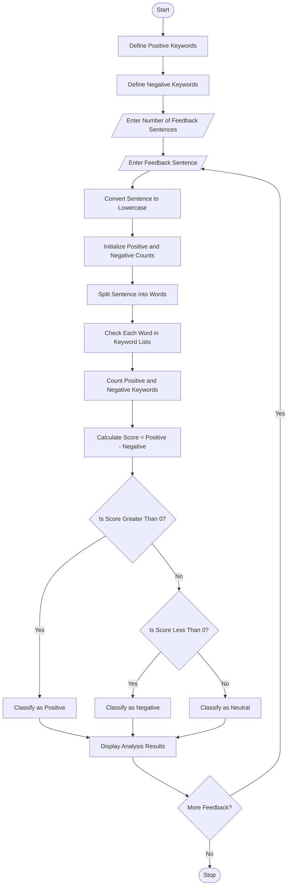

# Student Feedback Sentiment Scoring

## 1. Problem Statement

Develop a Python program to analyse multiple student feedback sentences using a predefined list of positive and negative keywords.

The program should:

- Accept multiple feedback sentences from students.
- Identify positive and negative keywords in each sentence.
- Count the number of positive and negative indicators.
- Calculate the sentiment score.
- Classify the feedback as Positive, Negative, or Neutral based on predefined thresholds.
- Display the feedback analysis and final results.

## 2. Algorithm

1. Start the program.
2. Define a list of positive keywords.
3. Define a list of negative keywords.
4. Read the number of feedback sentences.
5. Accept feedback sentences from the user.
6. Convert each sentence into lowercase.
7. Initialize positive and negative counts to zero.
8. Check each word against the positive keyword list.
9. Check each word against the negative keyword list.
10. Calculate the sentiment score using:

\\[ Score = Positive\ Count - Negative\ Count \\]

11. Classify the feedback:
    - Score greater than 0 → Positive.
    - Score less than 0 → Negative.
    - Score equal to 0 → Neutral.
12. Display positive count, negative count, score, and classification.
13. Repeat for all feedback sentences.
14. Stop the program.

## 3. Flowchart


## 4. Python Source Code

```
# Student Feedback Sentiment Scoringpositive_keywords = [    "good", "excellent", "great",    "helpful", "interesting", "amazing",    "best", "clear", "easy", "friendly"]negative_keywords = [    "bad", "poor", "worst",    "difficult", "boring", "slow",    "confusing", "hard", "waste", "weak"]# Get number of feedback sentencesn = int(input("Enter number of feedback sentences: "))for i in range(n):    print("\nFeedback", i + 1)    feedback = input("Enter feedback: ").lower()    # Initialize counters    positive_count = 0    negative_count = 0    # Split feedback into words    words = feedback.split()    # Count positive and negative keywords    for word in words:        word = word.strip(".,!?;:")        if word in positive_keywords:            positive_count += 1        if word in negative_keywords:            negative_count += 1    # Calculate sentiment score    score = positive_count - negative_count    # Classify feedback    if score > 0:        sentiment = "Positive"    elif score < 0:        sentiment = "Negative"    else:        sentiment = "Neutral"    # Display results    print("\n----- Feedback Analysis -----")    print("Positive Indicators:", positive_count)    print("Negative Indicators:", negative_count)    print("Sentiment Score:", score)    print("Feedback Classification:", sentiment)print("\nFeedback Analysis Completed!")
```

## 5. Sample Input

```
Enter number of feedback sentences: 3

Feedback 1
Enter feedback: The teaching is excellent and helpful

Feedback 2
Enter feedback: The subject is boring and difficult

Feedback 3
Enter feedback: The classroom is good but the teaching is slow
```

## 6. Sample Output

```
Feedback 1

----- Feedback Analysis -----
Positive Indicators: 2
Negative Indicators: 0
Sentiment Score: 2
Feedback Classification: Positive


Feedback 2

----- Feedback Analysis -----
Positive Indicators: 0
Negative Indicators: 2
Sentiment Score: -2
Feedback Classification: Negative


Feedback 3

----- Feedback Analysis -----
Positive Indicators: 1
Negative Indicators: 1
Sentiment Score: 0
Feedback Classification: Neutral


Feedback Analysis Completed!
```

## 7. Mermaid Flowchart Code


## 8. Result

The Python program successfully analyses multiple student feedback sentences, counts positive and negative keywords, calculates sentiment scores, and classifies feedback into Positive, Negative, and Neutral categories.

Note: This is a basic keyword-based sentiment analysis program. It does not understand context, sarcasm, or negation (for example, "not good").
