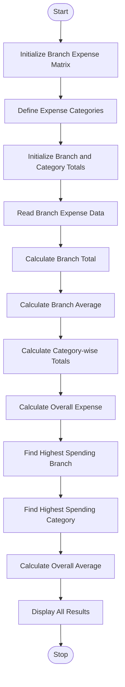

# Multi-Branch Expense Matrix Analysis

## 1. Problem Statement

Develop a Python program to analyse monthly expenses of multiple branches using nested lists (2D or 3D lists).

The program should:

- Store monthly expenses for different branches and categories.
- Calculate the total expenditure of each branch.
- Calculate the average expenditure of each branch.
- Calculate the total expenditure for each category.
- Identify the branch with the highest expenditure.
- Identify the category contributing the most to total expenses.
- Calculate the overall expenditure and average.

## 2. Algorithm

1. Start the program.
2. Create a nested list containing branch names and their monthly expenses.
3. Define expense categories such as Rent, Salaries, Electricity and Transport.
4. Initialize variables to store branch totals and category totals.
5. Read the expense data of each branch.
6. Calculate the total expenditure of each branch.
7. Calculate the average expenditure of each branch.
8. Calculate the total expenditure of each category.
9. Identify the branch with the highest expenditure.
10. Identify the category with the highest expenditure.
11. Calculate the overall expenditure and average.
12. Display all results.
13. Stop the program.

## 3. Flowchart


## 4. Python Source Code

```
for branch, expenses in branches.items():    total = sum(expenses)    average = total / len(expenses)    branch_totals[branch] = total    overall_total += total    for i in range(len(expenses)):        category_totals[i] += expenses[i]    print("\nBranch:", branch)    print("Total Expense:", total)    print("Average Expense:", average)# Find highest spending branchhighest_branch = max(branch_totals, key=branch_totals.get)# Find highest spending categoryhighest_category_index = category_totals.index(max(category_totals))# Calculate overall averageoverall_average = overall_total / (    len(branches) * len(categories))# Display final resultsprint("\n----- OVERALL ANALYSIS -----")print("Overall Expense:", overall_total)print("Overall Average:", overall_average)print("\nCategory-wise Expenses:")for i in range(len(categories)):    print(categories[i], ":", category_totals[i])print("\nHighest Spending Branch:", highest_branch)print("Highest Branch Expense:", branch_totals[highest_branch])print("Highest Spending Category:",      categories[highest_category_index])print("Highest Category Expense:",      category_totals[highest_category_index])
```

## 5. Sample Input

The program uses the following sample data:

```
Branches:
Vijayawada = [15000, 40000, 5000, 3000]
Hyderabad  = [20000, 50000, 7000, 5000]
Chennai    = [18000, 45000, 6000, 4000]

Categories:
1. Rent
2. Salaries
3. Electricity
4. Transport
```

## 6. Sample Output

```
Branch: Vijayawada
Total Expense: 63000
Average Expense: 15750.0

Branch: Hyderabad
Total Expense: 82000
Average Expense: 20500.0

Branch: Chennai
Total Expense: 73000
Average Expense: 18250.0

----- OVERALL ANALYSIS -----

Overall Expense: 218000
Overall Average: 18166.666666666668

Category-wise Expenses:
Rent : 53000
Salaries : 135000
Electricity : 18000
Transport : 12000

Highest Spending Branch: Hyderabad
Highest Branch Expense: 82000

Highest Spending Category: Salaries
Highest Category Expense: 135000
```

## 7. Mermaid Flowchart Code


## 8. Result

Thus, the Multi-Branch Expense Matrix Analysis program was successfully executed using Python nested lists and dictionaries. It calculates branch-wise totals, averages, category-wise expenses, overall expenditure, and identifies the highest spending branch and category.
