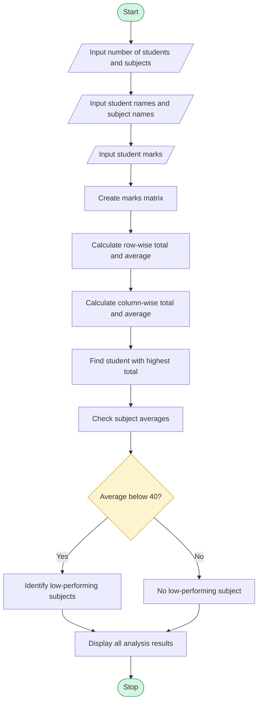

# Student Marks Matrix Analysis Using Python

## 1. Problem Statement

Write a Python program to analyse a matrix of student marks across multiple subjects. The program should:

1. Store student marks in a two-dimensional matrix.
2. Calculate the total and average marks of each student (row-wise).
3. Calculate the average marks of each subject (column-wise).
4. Identify the top-performing student based on the highest total marks.
5. Identify subjects with low average performance.
6. Display the analysis results clearly.

## 2. Algorithm

1. Start the program.
2. Read the number of students and subjects.
3. Read student names and subject names.
4. Create a two-dimensional matrix to store marks.
5. Calculate the total marks of each student.
6. Calculate the average marks of each student.
7. Calculate the total and average marks of each subject.
8. Find the student with the highest total marks.
9. Check subjects whose average marks are below 40.
10. Display student-wise and subject-wise statistics.
11. Display the top-performing student.
12. Display low-performing subjects.
13. Stop the program.

## 3. Flowchart

## 4. Python Source Code

```
        mark = float(input(f"{subjects[j]}: "))        row.append(mark)    marks.append(row)# Row-wise statisticsprint("\n--- STUDENT WISE ANALYSIS ---")totals = []averages = []for i in range(n):    total = sum(marks[i])    average = total / m    totals.append(total)    averages.append(average)    print(students[i],          "Total:", total,          "Average:", round(average, 2))# Column-wise statisticsprint("\n--- SUBJECT WISE ANALYSIS ---")subject_averages = []for j in range(m):    total = 0    for i in range(n):        total += marks[i][j]    average = total / n    subject_averages.append(average)    print(subjects[j],          "Total:", total,          "Average:", round(average, 2))# Find top performertop_index = totals.index(max(totals))print("\n--- TOP PERFORMER ---")print("Student:", students[top_index])print("Total Marks:", totals[top_index])print("Average Marks:", round(averages[top_index], 2))# Identify low-performing subjectsprint("\n--- LOW PERFORMING SUBJECTS ---")found = Falsefor j in range(m):    if subject_averages[j] < 40:        print(subjects[j],              "Average:", round(subject_averages[j], 2))        found = Trueif not found:    print("No low-performing subjects found.")print("\nAnalysis Completed!")
```

## 5. Sample Input

```
Enter number of students: 3
Enter number of subjects: 4

Enter student 1 name: Ravi
Enter student 2 name: Suresh
Enter student 3 name: Kumar

Enter subject 1 name: Python
Enter subject 2 name: Maths
Enter subject 3 name: Physics
Enter subject 4 name: English

Enter marks for Ravi:
Python: 85
Maths: 90
Physics: 35
English: 80

Enter marks for Suresh:
Python: 75
Maths: 80
Physics: 30
English: 70

Enter marks for Kumar:
Python: 95
Maths: 85
Physics: 40
English: 90
```

## 6. Sample Output

```
--- STUDENT WISE ANALYSIS ---

Ravi Total: 290.0 Average: 72.5
Suresh Total: 255.0 Average: 63.75
Kumar Total: 310.0 Average: 77.5

--- SUBJECT WISE ANALYSIS ---

Python Total: 255.0 Average: 85.0
Maths Total: 255.0 Average: 85.0
Physics Total: 105.0 Average: 35.0
English Total: 240.0 Average: 80.0

--- TOP PERFORMER ---

Student: Kumar
Total Marks: 310.0
Average Marks: 77.5

--- LOW PERFORMING SUBJECTS ---

Physics Average: 35.0

Analysis Completed!
```

## 7. Mermaid Flowchart Code


The Python program successfully analyses the student marks matrix, calculates row-wise and column-wise totals and averages, identifies the top-performing student, and detects subjects with average marks below 40.

Program Completed Successfully
