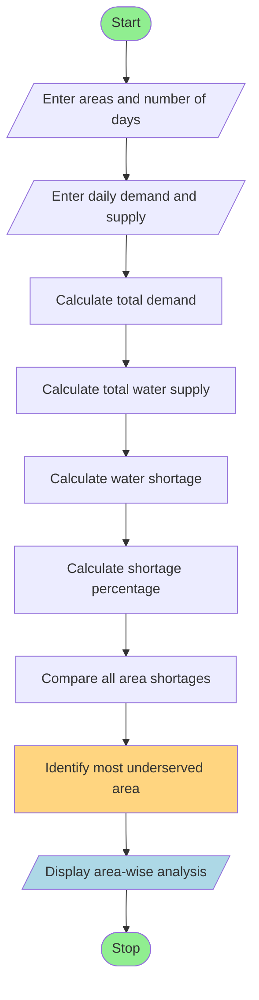

# Water Distribution Fairness Analysis

## 1. Problem Statement

Develop a Python program to analyse area-wise water supply across several days. The program calculates the total water demand, actual water supplied, and water shortage for each area. It compares the distribution levels and identifies the most underserved area based on the highest shortage percentage.

## 2. Algorithm

1. Start the program.
2. Read the number of areas and number of days.
3. Enter the names of the areas.
4. Enter the daily water demand and actual water supply for each area.
5. Calculate the total demand for each area.
6. Calculate the total water supplied to each area.
7. Calculate the shortage using:

`Shortage = Total Demand - Total Supply`

8\. Calculate the shortage percentage:

`Shortage Percentage = (Shortage / Total Demand) × 100`

9. Compare the shortage percentages of all areas.
10. Identify the most underserved area.
11. Display area-wise demand, supply, shortage, and shortage percentage.
12. Stop the program.

## 3. Flowchart



## 4. Python Source Code

```
# Water Distribution Fairness Analysisareas = ["Area A", "Area B", "Area C"]days = 3# Daily water demand (in litres)demand = [    [1000, 1200, 1100],    [1500, 1400, 1600],    [1000, 1000, 1200]]# Actual water supply (in litres)supply = [    [900, 1000, 950],    [1000, 1100, 1200],    [950, 900, 1100]]shortage_percentages = []print("WATER DISTRIBUTION FAIRNESS ANALYSIS")print("-" * 65)for i in range(len(areas)):    total_demand = sum(demand[i])    total_supply = sum(supply[i])    shortage = max(0, total_demand - total_supply)    shortage_percentage = (        shortage / total_demand    ) * 100 if total_demand > 0 else 0    shortage_percentages.append(shortage_percentage)    print("\nArea:", areas[i])    print("Total Demand:", total_demand, "litres")    print("Total Supply:", total_supply, "litres")    print("Shortage:", shortage, "litres")    print("Shortage Percentage:",          round(shortage_percentage, 2), "%")# Identify the most underserved areaindex = shortage_percentages.index(    max(shortage_percentages))print("\n" + "-" * 65)print("MOST UNDERSERVED AREA:", areas[index])print("Highest Shortage Percentage:",      round(shortage_percentages[index], 2), "%")print("\nAnalysis Completed.")
```

## 5. Sample Input

The following values are used in the program:

Number of areas: 3

Number of days: 3

| Area   | Day 1 Demand | Day 2 Demand | Day 3 Demand |
| ------ | ------------ | ------------ | ------------ |
| Area A | 1000         | 1200         | 1100         |
| Area B | 1500         | 1400         | 1600         |
| Area C | 1000         | 1000         | 1200         |

Water supply:

| Area   | Day 1 Supply | Day 2 Supply | Day 3 Supply |
| ------ | ------------ | ------------ | ------------ |
| Area A | 900          | 1000         | 950          |
| Area B | 1000         | 1100         | 1200         |
| Area C | 950          | 900          | 1100         |

## 6. Sample Output

```
WATER DISTRIBUTION FAIRNESS ANALYSIS
-----------------------------------------------------------------

Area: Area A
Total Demand: 3300 litres
Total Supply: 2850 litres
Shortage: 450 litres
Shortage Percentage: 13.64 %

Area: Area B
Total Demand: 4500 litres
Total Supply: 3300 litres
Shortage: 1200 litres
Shortage Percentage: 26.67 %

Area: Area C
Total Demand: 3200 litres
Total Supply: 2950 litres
Shortage: 250 litres
Shortage Percentage: 7.81 %

-----------------------------------------------------------------
MOST UNDERSERVED AREA: Area B
Highest Shortage Percentage: 26.67 %

Analysis Completed.
```


## 7. Mermaid Flowchart Code


Result: The Python program successfully analyses water distribution across multiple areas and days. It calculates demand, supply, shortages, and shortage percentages, and identifies Area B as the most underserved area with a 26.67% shortage.
