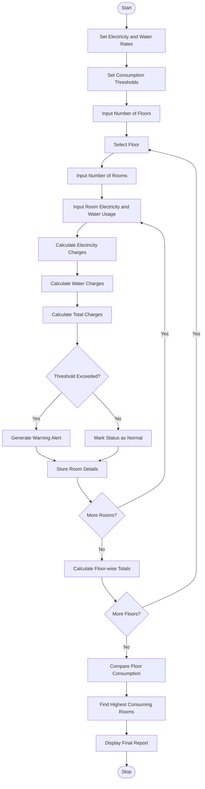

# Smart Hostel Resource Monitoring System (Python)

## 1. Problem Statement

Develop a Python program to monitor electricity and water consumption in different hostel rooms across multiple floors.

The system should:

1. Accept room-wise electricity consumption in units (kWh).
2. Accept room-wise water consumption in litres.
3. Calculate electricity and water charges.
4. Identify rooms exceeding predefined consumption thresholds.
5. Calculate total consumption and charges for each floor.
6. Compare resource utilization across floors.
7. Display the room with the highest electricity and water consumption.

## 2. Algorithm

1. Start the program.
2. Define electricity rate, water rate, and consumption thresholds.
3. Accept the number of floors.
4. For each floor, accept the number of rooms.
5. Enter room number, electricity consumption, and water consumption.
6. Calculate electricity charges.
7. Calculate water charges.
8. Calculate the total room charge.
9. Check whether electricity or water consumption exceeds the threshold.
10. Calculate floor-wise electricity and water consumption.
11. Compare resource utilization across floors.
12. Display room-wise and floor-wise reports.
13. Display the highest-consuming room.
14. Stop the program.

## 3. Flowchart



## 4. Python Source Code

```
    print(f"\nFloor {floor}")    for data in room_list:        print(            f"Room {data['room']} | "            f"Electricity: {data['electricity']} kWh | "            f"Water: {data['water']} L | "            f"Total Charge: Rs.{data['total_charge']:.2f} | "            f"Status: {data['status']}"        )# Floor-wise analysisprint("\n========== FLOOR-WISE ANALYSIS ==========")floor_summary = {}for floor, room_list in hostel.items():    total_electricity = sum(        r["electricity"] for r in room_list    )    total_water = sum(        r["water"] for r in room_list    )    total_charge = sum(        r["total_charge"] for r in room_list    )    floor_summary[floor] = {        "electricity": total_electricity,        "water": total_water,        "charge": total_charge    }    print(f"\nFloor {floor}")    print(f"Electricity: {total_electricity} kWh")    print(f"Water: {total_water} Litres")    print(f"Total Charges: Rs.{total_charge:.2f}")# Compare floorshighest_electricity_floor = max(    floor_summary,    key=lambda f: floor_summary[f]["electricity"])highest_water_floor = max(    floor_summary,    key=lambda f: floor_summary[f]["water"])# Find highest consuming roomsall_rooms = [    (floor, room)    for floor, room_list in hostel.items()    for room in room_list]highest_electricity_room = max(    all_rooms,    key=lambda x: x[1]["electricity"])highest_water_room = max(    all_rooms,    key=lambda x: x[1]["water"])print("\n========== FINAL SUMMARY ==========")print(
```

## 5. Sample Input

```
Enter number of floors: 2

--- Floor 1 ---
Enter number of rooms: 2

Room 1
Enter electricity consumption (kWh): 80
Enter water consumption (litres): 700

Room 2
Enter electricity consumption (kWh): 120
Enter water consumption (litres): 1500

--- Floor 2 ---
Enter number of rooms: 2

Room 1
Enter electricity consumption (kWh): 90
Enter water consumption (litres): 800

Room 2
Enter electricity consumption (kWh): 150
Enter water consumption (litres): 1200
```

## 6. Sample Output

```
========== ROOM-WISE REPORT ==========

Floor 1
Room 1 | Electricity: 80.0 kWh |
Water: 700.0 L | Total Charge: Rs.675.00 |
Status: Normal

Room 2 | Electricity: 120.0 kWh |
Water: 1500.0 L | Total Charge: Rs.1035.00 |
Status: High Electricity, High Water

Floor 2
Room 1 | Electricity: 90.0 kWh |
Water: 800.0 L | Total Charge: Rs.760.00 |
Status: Normal

Room 2 | Electricity: 150.0 kWh |
Water: 1200.0 L | Total Charge: Rs.1020.00 |
Status: High Electricity, High Water

========== FLOOR-WISE ANALYSIS ==========

Floor 1
Electricity: 200.0 kWh
Water: 2200.0 Litres
Total Charges: Rs.1710.00

Floor 2
Electricity: 240.0 kWh
Water: 2000.0 Litres
Total Charges: Rs.1780.00

========== FINAL SUMMARY ==========

Highest Electricity Floor: Floor 2
Highest Water Consumption Floor: Floor 1

Highest Electricity Room: Floor 2, Room 2
Highest Water Consumption Room: Floor 1, Room 2

Hostel Resource Monitoring Completed!
```

## 7. Mermaid Flowchart Code


## 8. Concepts Used

| Concept            | Application                   |
| ------------------ | ----------------------------- |
| Variables          | Store consumption and charges |
| Dictionary         | Store floor-wise data         |
| Nested Lists       | Store room details            |
| For Loop           | Process floors and rooms      |
| If-Else            | Check threshold violations    |
| Functions `sum()`  | Calculate total consumption   |
| Functions `max()`  | Identify highest consumption  |
| List Comprehension | Collect room records          |

Conclusion: This project monitors hostel electricity and water consumption, calculates room-wise charges, detects excessive usage, and compares resource utilization across different floors.
