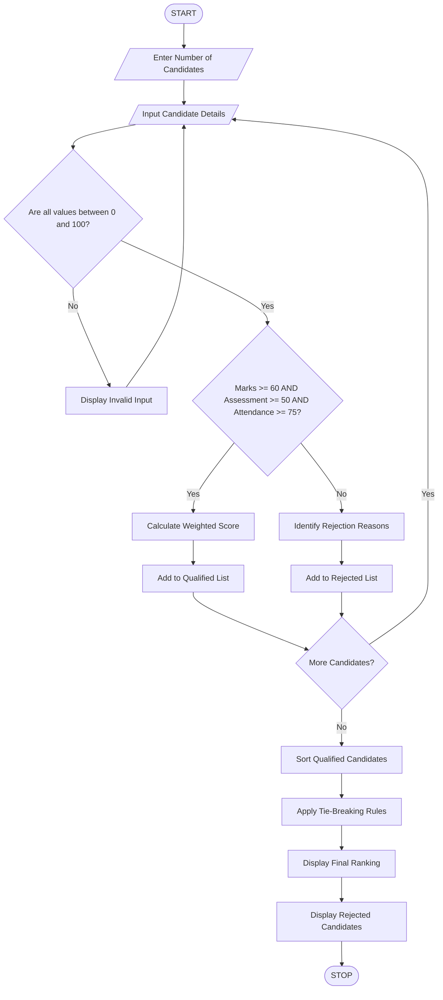

# Multi-Criteria Internship Candidate Ranking

## 1. Problem Statement

Develop a Python program to evaluate and rank internship candidates based on multiple criteria such as academic marks, assessment scores, attendance percentage, and eligibility conditions.

The program should:

1. Accept candidate details such as name, academic marks, assessment score, and attendance.
2. Check eligibility using predefined minimum requirements.
3. Calculate the overall score using weighted criteria.
4. Rank only qualified candidates based on their overall scores.
5. Apply deterministic tie-breaking rules when candidates have equal scores.
6. Display the final ranking and rejected candidates with reasons.

Eligibility Conditions:

- Academic marks must be at least 60%.
- Assessment score must be at least 50%.
- Attendance must be at least 75%.

Ranking Criteria:

- Academic marks: 40%
- Assessment score: 40%
- Attendance: 20%

Tie-breaking Rules:

1. Higher assessment score.
2. Higher academic marks.
3. Higher attendance.
4. Candidate name in alphabetical order.

## 2. Algorithm

1. Start the program.
2. Read the number of candidates.
3. For each candidate, input:
   - Candidate name.
   - Academic marks.
   - Assessment score.
   - Attendance percentage.
4. Check eligibility conditions.
5. If all conditions are satisfied:
   - Calculate the weighted score.
   - Add the candidate to the qualified list.
6. Otherwise, add the candidate to the rejected list with the rejection reason.
7. Sort qualified candidates using:
   - Overall score (descending).
   - Assessment score (descending).
   - Academic marks (descending).
   - Attendance (descending).
   - Name (ascending).
8. Display the ranked qualified candidates.
9. Display rejected candidates.
10. Stop.

## 3. Flowchart



## 4. Python Source Code

```
    if marks < 60:        reasons.append("Academic marks below 60%")    if assessment < 50:        reasons.append("Assessment score below 50%")    if attendance < 75:        reasons.append("Attendance below 75%")    candidate = {        "name": name,        "marks": marks,        "assessment": assessment,        "attendance": attendance    }    if not reasons:        # Calculate weighted score        score = (            marks * 0.40 +            assessment * 0.40 +            attendance * 0.20        )        candidate["total"] = score        qualified.append(candidate)    else:        candidate["reason"] = ", ".join(reasons)        rejected.append(candidate)# Sort candidates using tie-breaking rulesqualified.sort(    key=lambda x: (        -x["total"],        -x["assessment"],        -x["marks"],        -x["attendance"],        x["name"].casefold()    ))# Display qualified candidatesprint("\n========== FINAL INTERNSHIP RANKING ==========")if qualified:    print("Rank  Name       Marks  Assessment  Attendance  Score")    for rank, c in enumerate(qualified, start=1):        print(            f"{rank:<5} "            f"{c['name']:<10} "            f"{c['marks']:<7.1f} "            f"{c['assessment']:<12.1f} "            f"{c['attendance']:<12.1f} "            f"{c['total']:.2f}"        )else:    print("No qualified candidates found.")# Display rejected candidatesprint("\n========== REJECTED CANDIDATES ==========")if rejected:    for c in rejected:        print(f"\nName: {c['name']}")        print(f"Reason: {c['reason']}")else:    print("No rejected candidates.")
```

## 5. Sample Input

```
Enter number of candidates: 5

Enter details of Candidate 1
Candidate Name: Rahul
Academic Marks (%): 85
Assessment Score (%): 90
Attendance (%): 95

Enter details of Candidate 2
Candidate Name: Arjun
Academic Marks (%): 90
Assessment Score (%): 85
Attendance (%): 90

Enter details of Candidate 3
Candidate Name: Kiran
Academic Marks (%): 55
Assessment Score (%): 80
Attendance (%): 90

Enter details of Candidate 4
Candidate Name: Varun
Academic Marks (%): 80
Assessment Score (%): 90
Attendance (%): 85

Enter details of Candidate 5
Candidate Name: Ajay
Academic Marks (%): 75
Assessment Score (%): 65
Attendance (%): 70
```

## 6. Sample Output

```
========== FINAL INTERNSHIP RANKING ==========

Rank  Name       Marks  Assessment  Attendance  Score
1     Rahul      85.0   90.0        95.0        89.00
2     Arjun      90.0   85.0        90.0        88.00
3     Varun      80.0   90.0        85.0        85.00

========== REJECTED CANDIDATES ==========

Name: Kiran
Reason: Academic marks below 60%

Name: Ajay
Reason: Attendance below 75%
```

## 7. Mermaid Flowchart Code


## 8. Expected Concepts Used

| Python concept       | Purpose                         |
| -------------------- | ------------------------------- |
| List                 | Store candidates                |
| Dictionary           | Store candidate details         |
| For loop             | Accept multiple candidates      |
| If-else              | Check eligibility               |
| Functions            | Not required in this version    |
| Sorting              | Rank candidates                 |
| Lambda               | Apply multiple sorting criteria |
| Arithmetic operators | Calculate weighted score        |

Conclusion: This program evaluates internship candidates using multiple criteria, filters eligible candidates, calculates weighted scores, and generates a fair ranking with deterministic tie-breaking rules.
